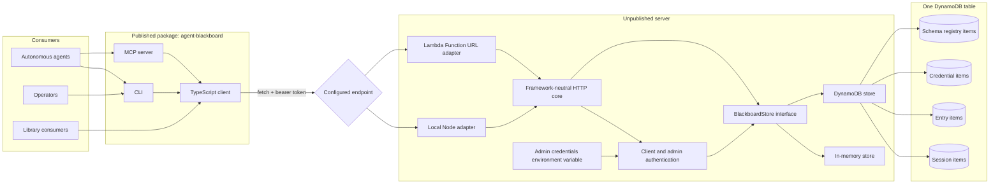

# Architecture

## Request flow

The published package uses `fetch` to call a framework-neutral HTTP core. The same core runs behind
the local Node server and the Lambda Function URL adapter. Production storage uses DynamoDB; tests
and local development can use the in-memory store.

## Data model

One DynamoDB table stores multiple item types. There are no joins and no nested entry arrays.

| Entity          | Partition key                        | Sort key                           | Public fields                                                                                  |
| --------------- | ------------------------------------ | ---------------------------------- | ---------------------------------------------------------------------------------------------- |
| Session         | `SESSIONS#<credentialId>`            | `SESSION#<sessionId>`              | `id`, `parentSessionId`, `agent`, `version`, `createdAt`, `lastEntryAt`, `archivedAt`, `data`  |
| Entry           | `ENTRIES#<credentialId>#<sessionId>` | `ENTRY#<createdAt>`                | `sessionId`, `createdAt`, `data`, optional `schemaId`, `schemaVersion`, `sourceEventId`        |
| Source event    | `SOURCE_EVENTS#<credId>#<sessionId>` | `SOURCE_EVENT#<sourceEventId>`     | internal idempotency index (`contentHash`, `entryCreatedAt`, TTL)                              |
| Credential      | internal credential partition        | internal credential sort key       | `id`, `name`, `createdAt`                                                                      |
| Schema registry | `SCHEMA_REGISTRY`                    | `META`                             | monotonic `revision`, `updatedAt`                                                              |
| Schema head     | `SCHEMAS`                            | `SCHEMA#<schemaId>`                | `id`, `latestVersion`, `deprecatedAt`, `deprecatedBy`, audit timestamps/actors                 |
| Schema version  | `SCHEMA_VERSIONS`                    | `SCHEMA#<schemaId>#V#<padded-ver>` | `id`, `version`, `ref`, `schema`, `mode`, `createdAt`, `createdBy`, `promotedAt`, `promotedBy` |
| Shadow count    | `SCHEMA_SHADOW_COUNTS#<schemaId>`    | `V#<padded-ver>`                   | `schemaId`, `schemaVersion`, `failureCount`, `lastFailureAt`                                   |
| Shadow failure  | `SCHEMA_SHADOW_FAILURES#<id>#V#<v>`  | `<occurredAt>#<uuid>`              | `schemaId`, `schemaVersion`, `sessionId`, `occurredAt`, `code`, `message`, `details` (TTL)     |

Each entry is independently writable and queryable. Entry identity is `(sessionId, createdAt)`;
timestamps are allocated by the service and are collision-safe within a session. TTL is an internal
entry attribute derived from `createdAt`.

## Session invariants

- The caller supplies every session id. No layer infers or generates ids. Ids contain only letters,
  numbers, `.`, `_`, `:`, and `-`.
- A root has `parentSessionId: null`.
- A subagent creates its own session with the direct parent's id.
- Parent and child must belong to the same client credential.
- The parent must exist when the child is created; archived parents remain valid.
- Parent relationships are immutable.
- `agent` and `version` are required caller-supplied session metadata.
- Session `data` is unstructured JSON and patches shallow-merge it.
- Every entry append updates `lastEntryAt` and receives a TTL based on its own `createdAt`.
- Archiving sets `archivedAt` exactly once after distillation. Archived sessions and entries remain
  readable; metadata patches are blocked, while entries and new children remain allowed.
- Session metadata has no TTL and remains addressable after all of its entries expire.

DynamoDB transactions combine the session metadata update with each entry write, keeping
`lastEntryAt` monotonic and entry identities unique under concurrent appends.

## HTTP API

| Method          | Path                                     | Purpose                                                                                                   |
| --------------- | ---------------------------------------- | --------------------------------------------------------------------------------------------------------- |
| `POST`          | `/sessions`                              | Create `{ id, parentSessionId, agent, version }`                                                          |
| `GET`           | `/sessions`                              | List sessions; supports archive and inactivity filters                                                    |
| `GET`           | `/sessions/:id`                          | Get session metadata                                                                                      |
| `PATCH`         | `/sessions/:id`                          | Patch `{ data }` or archive with `{ archived: true }`                                                     |
| `POST`          | `/sessions/:id/entries`                  | Append `{ data, schemaId?, schemaVersion?, sourceEventId? }` (`201` new, `200` duplicate, `409` conflict) |
| `GET`           | `/sessions/:id/entries`                  | Stream entries (`json`, `jsonl`, or `markdown`)                                                           |
| `GET`           | `/snapshot`                              | Stream all selected active sessions and entries as JSONL                                                  |
| `GET`           | `/schemas`                               | List schema summaries (`?include=versions` returns full bundle; supports ETag)                            |
| `GET`           | `/schemas/:id`                           | Get latest version and metadata for a schema                                                              |
| `GET`           | `/schemas/:id/versions`                  | List immutable version history for a schema                                                               |
| `GET`           | `/schemas/:id/versions/:version`         | Get a specific immutable schema version                                                                   |
| `PUT`           | `/schemas/:id`                           | Admin-only: publish next JSON Schema 2020-12 version (`breaking?`, `shadow?`)                             |
| `POST`          | `/schemas/:id/versions/:version/promote` | Admin-only: switch a shadow schema version to `enforced`                                                  |
| `GET`           | `/schemas/:id/report`                    | Admin-only: shadow failure counts and recent examples across schema versions                              |
| `GET`           | `/schemas/:id/versions/:version/report`  | Admin-only: shadow failure counts and recent examples for one schema version                              |
| `DELETE`        | `/schemas/:id`                           | Admin-only: deprecate a schema without deleting its history                                               |
| `GET`           | `/health`                                | Unauthenticated readiness check (`200` ok, `503` if `required` has no enforced schema)                    |
| `/credentials*` | admin routes                             | Manage client credentials                                                                                 |

Every authenticated response includes `x-schema-registry-revision: <n>` so clients can detect when
their local pulled schema cache is behind the server. `GET /schemas` and
`GET /schemas?include=versions` emit `ETag: "rev-<n>"` and honor `If-None-Match` with `304 Not
Modified`.

Entry writes naming `schemaId` are validated against the registered JSON Schema 2020-12 document.
`AGENT_BLACKBOARD_SCHEMA_ENFORCEMENT` controls the server-wide policy: `optional` (default — allows
entries without `schemaId`, enforces named schemas unless that version is in `shadow` mode),
`shadow` (validates every entry naming a schema but rejects nothing), or `required` (also rejects
entries missing `schemaId`). In `required` mode, the registry must hold at least one active
(non-deprecated) enforced schema: `local-server` refuses to start otherwise, and `GET /health`
returns `503` with guidance to register and promote a schema or switch to `shadow`. When a newer version is registered in `shadow` mode on top of an
already-enforced version, unpinned writes continue enforcing the latest prior enforced version and
also shadow-validate against the newer shadow version. When a validation fails in per-version or
global shadow mode, the server accepts the entry (`201`), attaches a `warning` object (`code`,
`message`, and diagnostic `details`) to the write response, omits `schemaId`/`schemaVersion` unless
the entry satisfied an enforced baseline version, and records metadata plus diagnostics server-side
without the entry payload.

## Authentication

Client tokens use `abb_sk_<credentialId>_<secret>` and are hashed in DynamoDB. Admin tokens use
`abb_admin_<name>_<secret>` and exist only in the server's
`AGENT_BLACKBOARD_ADMIN_CREDENTIALS` environment variable. Client tokens cannot access credential
routes, schema write routes (`PUT`/`DELETE /schemas/:id`, `POST /schemas/:id/versions/:version/promote`),
or admin shadow report routes (`GET /schemas/:id[/versions/:version]/report`); admin tokens cannot
access session or entry routes. Other schema read routes (`GET /schemas*`) accept either a client
token or an admin token.

Before storing entry `data` (`POST /sessions/:id/entries`) or session patch `data`
(`PATCH /sessions/:id`), the server recursively redacts known credential formats across both object
keys and string values — including `abb_sk_` and `abb_admin_` tokens, common provider API tokens
(GitHub, OpenAI, Anthropic, AWS access keys, Slack, Stripe, Google, npm, PyPI), PEM private keys
(including truncated blocks), and generic `Bearer` tokens — replacing each match with
`[REDACTED:<kind>]`. For entry writes, redaction runs before JSON Schema validation so stored entry
data always matches the validated payload. When one or more values were redacted, the write response
includes `redactedCount` (a count only, never the redacted value).

## Streaming

The store exposes entries as an `AsyncIterable`. The HTTP layer can emit JSON arrays, JSONL, or
Markdown without loading a session's entire entry history. The library defaults to incremental
JSONL parsing; the CLI relays response bytes directly.

`GET /snapshot` streams each selected active session followed by its entries and ends with a
terminal manifest. Session blocks are ordered by `createdAt` (ties have no further ordering
guarantee), and entries by `createdAt` within their session. The snapshot is best-effort rather than transactional: appends concurrent
with the scan may or may not appear. The response is capped at 190 MiB; an oversized stream ends
with a `snapshot_too_large` error record instead of a complete manifest.
